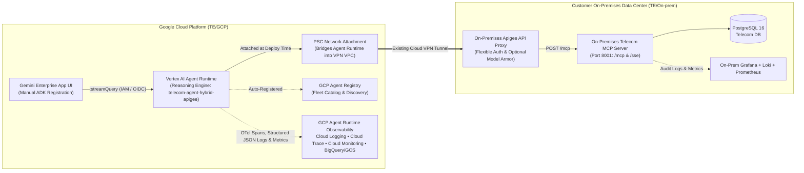

<!--
  Purpose: Architecture, PSC pre-deployment setup, Cloud Shell installation/uninstallation, observability, Agent Registry, and Gemini Enterprise registration guide for the GCP Telecom ADK Agent on Vertex AI Agent Runtime.
  Architecture/Context: Governs the GCP-resident Google ADK Agent (running exclusively on Vertex AI Agent Runtime) sending traffic over an existing Cloud VPN (bridged via PSC Network Attachment) to the On-Premises Apigee API Proxy and MCP Server (`TE/On-prem`).
  Dependencies/Side Effects: Requires Google Cloud Shell (`gcloud`), `uv`, and `google-agents-cli`.
-->

# Telecom Customer Care ADK Agent — GCP Agent Runtime (`TE/GCP`)

This directory ([`TE/GCP/`](file:///usr/local/google/home/pradeesi/Documents/jetski/TE/GCP)) contains the **Google Agent Development Kit (ADK) Agent** deployed exclusively on **Google Cloud Agent Runtime (Vertex AI Reasoning Engines)**.

The agent sends traffic over your existing **Google Cloud VPN** connection (bridged into your VPC via a **Private Service Connect (PSC) Network Attachment**) to the **On-Premises Apigee API Proxy** (`MCP_SERVER_URL`), which forwards requests to the **On-Premises Telecom MCP Server** ([`TE/On-prem/`](file:///usr/local/google/home/pradeesi/Documents/jetski/TE/On-prem)). Once deployed on GCP Agent Runtime via [`./install.sh`](file:///usr/local/google/home/pradeesi/Documents/jetski/TE/GCP/install.sh) in **Google Cloud Shell**, the agent is automatically registered in **GCP Agent Registry**, monitored with **GCP Agent Runtime Logging, Cloud Trace, and Cloud Monitoring**, and ready for manual registration into the **Gemini Enterprise App** UI.

---

## Application Architecture



### Core Architectural Capabilities

1. **Strict 8-Tool Telecom Domain Scope**:
   - The ADK Agent (`gemini-2.5-flash`) is strictly bounded to the 8 telecom customer-care MCP tools (`search_customer`, `get_customer_360`, `get_service_diagnostics`, `run_remote_device_action`, `check_network_outages`, `get_billing_breakdown`, `get_upsell_recommendations`, `log_agent_interaction`).
   - Any out-of-scope prompt is deterministically refused with a standardized compliance message.
2. **Private Cloud VPN Connectivity via PSC Network Attachment**:
   - Cloud VPN itself is managed externally in your GCP VPC. To allow the serverless Vertex AI Agent Runtime instance (which runs in a Google-managed tenant project) to send traffic into your VPC and across the existing Cloud VPN to a private on-premises Apigee IP, Agent Runtime attaches to a **Private Service Connect (PSC) Network Attachment** (`NETWORK_ATTACHMENT`) created in your VPN-connected VPC before agent deployment.
3. **Flexible Apigee Authentication (`APIGEE_AUTH_MODE`)**:
   - Because on-premises Apigee authentication policies can vary across environments, [`app/config.py`](file:///usr/local/google/home/pradeesi/Documents/jetski/TE/GCP/app/config.py) and [`app/tools.py`](file:///usr/local/google/home/pradeesi/Documents/jetski/TE/GCP/app/tools.py) support plug-and-play authentication modes via `.env` without code changes:
     - `auto` *(default)*: Automatically attaches credentials based on which environment variables are populated (`APIGEE_API_KEY`, `MCP_AUTH_TOKEN`, `APIGEE_BEARER_TOKEN`, `APIGEE_CUSTOM_HEADER_NAME`, or `APIGEE_BASIC_USER`), or sends unauthenticated requests if none are set.
     - `none`: Sends no authentication headers.
     - `api_key`: Sends `APIGEE_API_KEY` in the header specified by `APIGEE_API_KEY_HEADER` (default: `x-apikey`).
     - `bearer`: Sends `Authorization: Bearer <token>` and `X-MCP-Token: <token>`.
     - `google_id_token`: Mints a Google OIDC ID token from the Agent Runtime metadata server and sends `Authorization: Bearer <id_token>`.
     - `basic`: Sends `Authorization: Basic <base64(user:password)>`.
     - `custom_header`: Sends `<APIGEE_CUSTOM_HEADER_NAME>: <APIGEE_CUSTOM_HEADER_VALUE>`.
4. **GCP Agent Registry Integration**:
   - Enables `agentregistry.googleapis.com` and deploys to Vertex AI Agent Runtime with SPIFFE Agent Identity (`--agent-identity`), registering the agent in **GCP Agent Registry** for centralized fleet governance.
5. **Full Agent Runtime Logging, Tracing & Monitoring**:
   - **Cloud Trace**: OpenTelemetry spans (`invoke_agent`, `call_llm`, `execute_tool`) exported automatically via `GOOGLE_CLOUD_AGENT_ENGINE_ENABLE_TELEMETRY=true`.
   - **Cloud Logging**: Structured JSON logs emitted on every MCP tool invocation (`mcp_tool_call_started`, `mcp_tool_call_completed`, `mcp_tool_call_http_error`, `mcp_tool_blocked_by_model_armor`) correlated with `logging.googleapis.com/trace`.
   - **Cloud Monitoring**: Custom log-based metrics (`telecom_agent_mcp_tool_calls_total`, `telecom_agent_mcp_tool_errors_total`, `telecom_agent_model_armor_blocks_total`) and a pre-built **Cloud Monitoring Dashboard** (`Telecom ADK Agent Runtime & Apigee VPN Observability`) provisioned automatically by [`install.sh`](file:///usr/local/google/home/pradeesi/Documents/jetski/TE/GCP/install.sh).
   - **GCS & BigQuery Telemetry**: Full GenAI prompt/response completion logging to GCS (`gs://<PROJECT_ID>-telecom-agent-logs`) and a Cloud Logging BigQuery sink (`telecom_agent_hybrid_apigee_telemetry`) provisioned automatically by [`install.sh`](file:///usr/local/google/home/pradeesi/Documents/jetski/TE/GCP/install.sh).

---

## Project Directory Structure

```text
TE/GCP/
├── .env.example                          # Template environment configuration (PSC, Apigee URL/Auth, Telemetry)
├── .gitignore                            # Excludes .env, virtualenvs, caches, and deployment_metadata.json
├── Dockerfile                            # Container definition required by `agents-cli deploy` for Agent Runtime
├── README.md                             # Architecture, PSC setup, Cloud Shell installation, and Gemini Enterprise guide
├── agents-cli-manifest.yaml              # Google Agents CLI manifest (deployment_target: agent_runtime)
├── install.sh                            # Interactive Cloud Shell installer (numbered GCP project menu)
├── uninstall.sh                          # Interactive Cloud Shell uninstaller (numbered GCP project menu)
├── pyproject.toml                        # Python package dependencies (google-adk[gcp,mcp], a2a-sdk, telemetry)
├── uv.lock                               # Locked deterministic dependency graph
├── app/                                  # ADK Agent application package
│   ├── __init__.py                       # Exports root AdkApp
│   ├── agent.py                          # Root LlmAgent definition, Gemini 2.5 Flash config & strict scope prompt
│   ├── config.py                         # Pydantic settings for Apigee URL, flexible auth modes & telemetry
│   ├── fast_api_app.py                   # Agent Runtime container entrypoint (:query, :streamQuery, A2A routes)
│   ├── tools.py                          # 8 telecom MCP tools with flexible Apigee auth & structured GCP logging
│   └── app_utils/                        # Agent Runtime adapters and OpenTelemetry instrumentation
│       ├── a2a.py                        # Agent-to-Agent (A2A) protocol & /.well-known/agent-card.json routes
│       ├── reasoning_engine_adapter.py   # Vertex AI Reasoning Engine (:query & :streamQuery) adapter
│       ├── services.py                   # Shared VertexAiSessionService and GcsArtifactService wiring
│       ├── telemetry.py                  # Agent Runtime Cloud Trace, Cloud Logging & GCS completion setup
│       └── typing.py                     # Feedback payload schema for Cloud Logging -> BigQuery sink
├── skills/
│   └── telecom_customer_care_agent/
│       └── SKILL.md                      # Optional turn-by-turn Contact Center playbook for Gemini Enterprise
└── tests/
    └── unit/
        └── test_agent.py                 # Unit tests for 8 MCP tools, scope guard & flexible Apigee auth modes
```

---

## Frameworks & Libraries

- **Agent Framework**: [Google Agent Development Kit (ADK)](https://adk.dev/) (`google-adk[gcp,mcp]>=2.0.0,<3.0.0`)
- **Foundation Model**: `gemini-2.5-flash` via `google-genai` and Vertex AI
- **Managed Runtime**: [Vertex AI Agent Runtime (Reasoning Engines)](https://cloud.google.com/vertex-ai/generative-ai/docs/agent-engine/overview) (`google-cloud-aiplatform[evaluation,agent-engines]>=1.156.0`)
- **Interop & Transport**: `a2a-sdk[http-server]~=0.3.22`, `httpx>=0.27.0`, `fastapi`, `uvicorn`
- **Observability**: `opentelemetry-instrumentation-google-genai>=0.1.0`, `google-cloud-logging>=3.12.0`
- **Configuration & Packaging**: `pydantic-settings>=2.2.0`, `uv`, `google-agents-cli`

---

## Environment Variables

All configuration is externalized via environment variables or `.env` (copied from [`.env.example`](file:///usr/local/google/home/pradeesi/Documents/jetski/TE/GCP/.env.example) and updated interactively by [`./install.sh`](file:///usr/local/google/home/pradeesi/Documents/jetski/TE/GCP/install.sh)).

| Variable | Type | Default / Example | Purpose |
| :--- | :--- | :--- | :--- |
| `GOOGLE_GENAI_USE_VERTEXAI` | `bool` | `true` | Uses Vertex AI backend for Gemini model calls. |
| `GOOGLE_CLOUD_PROJECT` | `string` | `pradeesi-ai-demo` | **Required.** Target Google Cloud Project ID. |
| `GOOGLE_CLOUD_LOCATION` | `string` | `us-central1` | Target GCP region for Agent Runtime and Agent Registry. |
| `MODEL_NAME` | `string` | `gemini-2.5-flash` | Gemini model used by the ADK Agent. |
| `NETWORK_ATTACHMENT` | `string` | `projects/.../networkAttachments/...` | PSC Network Attachment resource URI bridging Agent Runtime into your Cloud VPN VPC. **Must be created before deploying the agent** if Apigee uses a private RFC 1918 IP. |
| `MCP_SERVER_URL` | `string` | `https://apigee.onprem.internal/telecom-mcp` | **Required.** Base URL of the On-Premises Apigee API Proxy reached over Cloud VPN. |
| `APIGEE_VERIFY_SSL` | `bool` | `true` | Set to `false` if the on-premises Apigee endpoint uses a self-signed or private CA TLS certificate. |
| `APIGEE_AUTH_MODE` | `string` | `auto` | Apigee authentication strategy: `auto`, `none`, `api_key`, `bearer`, `google_id_token`, `basic`, or `custom_header`. |
| `APIGEE_API_KEY` | `string` | *(empty)* | API Key value when `APIGEE_AUTH_MODE` is `api_key` or `auto`. |
| `APIGEE_API_KEY_HEADER` | `string` | `x-apikey` | Header name used to send `APIGEE_API_KEY`. |
| `MCP_AUTH_TOKEN` | `string` | *(empty)* | Static Bearer token sent as `Authorization: Bearer <token>` and `X-MCP-Token` when `APIGEE_AUTH_MODE` is `bearer` or `auto`. |
| `APIGEE_BEARER_TOKEN` | `string` | *(empty)* | Alias for `MCP_AUTH_TOKEN` in `bearer` or `auto` mode. |
| `APIGEE_OIDC_AUDIENCE` | `string` | *(empty)* | Target audience URI when `APIGEE_AUTH_MODE=google_id_token` (defaults to `MCP_SERVER_URL`). |
| `APIGEE_BASIC_USER` | `string` | *(empty)* | Username when `APIGEE_AUTH_MODE=basic`. |
| `APIGEE_BASIC_PASSWORD` | `string` | *(empty)* | Password when `APIGEE_AUTH_MODE=basic`. |
| `APIGEE_CUSTOM_HEADER_NAME` | `string` | *(empty)* | Custom auth header name when `APIGEE_AUTH_MODE=custom_header`. |
| `APIGEE_CUSTOM_HEADER_VALUE` | `string` | *(empty)* | Custom auth header value when `APIGEE_AUTH_MODE=custom_header`. |
| `ENABLE_AGENT_IDENTITY` | `bool` | `true` | Enables SPIFFE workload identity (`--agent-identity`) on Agent Runtime. |
| `GOOGLE_CLOUD_AGENT_ENGINE_ENABLE_TELEMETRY` | `bool` | `true` | Enables native Agent Runtime Cloud Trace & Cloud Logging instrumentation. |
| `OTEL_INSTRUMENTATION_GENAI_CAPTURE_MESSAGE_CONTENT` | `string` | `EVENT_ONLY` | Controls GenAI message capture (`EVENT_ONLY`, `SPAN_AND_EVENT`, `SPAN_ONLY`, `NO_CONTENT`). |
| `LOGS_BUCKET_NAME` | `string` | `<PROJECT_ID>-telecom-agent-logs` | GCS bucket name storing full GenAI prompt/response JSONL completions. |

---

## No Hardcoding Rule

> [!IMPORTANT]
> **Zero Hardcoded Secrets**: No API keys, Bearer tokens, passwords, or project-specific credentials are hardcoded in the source code. Always configure runtime settings in `.env` (excluded via [`.gitignore`](file:///usr/local/google/home/pradeesi/Documents/jetski/TE/GCP/.gitignore)) or inject secrets from Google Cloud Secret Manager (`agents-cli deploy --secrets`).

---

## Pre-Deployment: Private Service Connect (PSC) Creation & Configuration

> [!IMPORTANT]
> **Must Be Created Before Agent Deployment (If Using Private IPs over Cloud VPN)**:
> - Your **Cloud VPN** is assumed to be already configured on your GCP VPC by your network team.
> - However, creating a Cloud VPN does **not** automatically create a Private Service Connect (PSC) Network Attachment.
> - Because Vertex AI Agent Runtime runs in a Google-managed tenant project outside your VPC — and its **PSC configuration is immutable once the agent is deployed** — you **must** create the PSC Network Attachment in your VPN-connected VPC **before** running `./install.sh` if your On-Premises Apigee endpoint uses a private RFC 1918 IP address (`10.x.x.x`, `172.16.x.x`, `192.168.x.x`).

### Run in Google Cloud Shell (Before Installing the Agent)

Open [Google Cloud Shell](https://shell.cloud.google.com) and run the following commands to create a dedicated subnet and PSC Network Attachment inside the VPC where your Cloud VPN is already terminated:

```bash
export PROJECT_ID="your-gcp-project-id"
export REGION="us-central1"
export VPN_VPC_NAME="your-existing-vpn-vpc"          # e.g., default or hybrid-vpn-vpc
export PSC_SUBNET_NAME="telecom-agent-psc-subnet"
export PSC_SUBNET_CIDR="10.240.0.0/24"               # Non-overlapping /24 CIDR in your VPC
export ATTACHMENT_NAME="telecom-agent-psc-attachment"

# 1. Create a subnet in your existing VPN-connected VPC for the PSC interface
gcloud compute networks subnets create "${PSC_SUBNET_NAME}" \
  --project="${PROJECT_ID}" \
  --network="${VPN_VPC_NAME}" \
  --region="${REGION}" \
  --range="${PSC_SUBNET_CIDR}"

# 2. Create the PSC Network Attachment so Agent Runtime can attach to your VPN VPC
gcloud compute network-attachments create "${ATTACHMENT_NAME}" \
  --project="${PROJECT_ID}" \
  --region="${REGION}" \
  --subnets="${PSC_SUBNET_NAME}" \
  --connection-preference=ACCEPT_AUTOMATIC

# 3. Print the full PSC Network Attachment resource URI (used in ./install.sh below)
export NETWORK_ATTACHMENT="projects/${PROJECT_ID}/regions/${REGION}/networkAttachments/${ATTACHMENT_NAME}"
echo "PSC Network Attachment URI: ${NETWORK_ATTACHMENT}"
```

*(Note for your Network/VPN Administrator: Ensure your Cloud Router / Cloud VPN advertises `${PSC_SUBNET_CIDR}` (`10.240.0.0/24`) to the on-premises network so return packets from the on-premises Apigee proxy route back to the Agent Runtime PSC interface).*

---

## Google Cloud Shell Installation & Uninstallation Guide

All installation, verification, and uninstallation steps are designed to be executed directly from **Google Cloud Shell** (`https://shell.cloud.google.com`). You do not need to manually install Python, `uv`, or `google-agents-cli` beforehand — [`./install.sh`](file:///usr/local/google/home/pradeesi/Documents/jetski/TE/GCP/install.sh) installs all prerequisites and runs pre-flight unit tests automatically inside Cloud Shell.

### Step 1: Clone the Repository in Google Cloud Shell

In [Google Cloud Shell](https://shell.cloud.google.com), run:

```bash
git clone https://github.com/pradeesi/TE.git
cd TE/GCP
chmod +x install.sh uninstall.sh
```

---

### Step 2: (Optional) Configure Apigee Authentication & PSC URI in `.env`

If you created a PSC Network Attachment in the pre-deployment section above or want to pre-configure Apigee authentication credentials before running the installer:

```bash
cp .env.example .env
nano .env
```

Choose whichever Apigee authentication mode matches your Apigee proxy configuration:

- **Case 1 — No Authentication (`APIGEE_AUTH_MODE=none` or `auto`)**:
  ```dotenv
  NETWORK_ATTACHMENT=projects/your-gcp-project-id/regions/us-central1/networkAttachments/telecom-agent-psc-attachment
  MCP_SERVER_URL=https://apigee.onprem.internal/telecom-mcp
  APIGEE_AUTH_MODE=none
  APIGEE_VERIFY_SSL=false
  ```
- **Case 2 — Apigee `VerifyAPIKey` Policy (`APIGEE_AUTH_MODE=api_key`)**:
  ```dotenv
  NETWORK_ATTACHMENT=projects/your-gcp-project-id/regions/us-central1/networkAttachments/telecom-agent-psc-attachment
  MCP_SERVER_URL=https://apigee.onprem.internal/telecom-mcp
  APIGEE_AUTH_MODE=api_key
  APIGEE_API_KEY=your-apigee-consumer-key
  APIGEE_API_KEY_HEADER=x-apikey
  ```
- **Case 3 — Static Bearer Token (`APIGEE_AUTH_MODE=bearer`)**:
  ```dotenv
  NETWORK_ATTACHMENT=projects/your-gcp-project-id/regions/us-central1/networkAttachments/telecom-agent-psc-attachment
  MCP_SERVER_URL=https://apigee.onprem.internal/telecom-mcp
  APIGEE_AUTH_MODE=bearer
  MCP_AUTH_TOKEN=your-bearer-token
  ```
- **Case 4 — Google OIDC ID Token (`APIGEE_AUTH_MODE=google_id_token`)**:
  ```dotenv
  NETWORK_ATTACHMENT=projects/your-gcp-project-id/regions/us-central1/networkAttachments/telecom-agent-psc-attachment
  MCP_SERVER_URL=https://apigee.onprem.internal/telecom-mcp
  APIGEE_AUTH_MODE=google_id_token
  ```

---

### Step 3: Run the Interactive Installer (`./install.sh`) in Google Cloud Shell

Launch the installer from Google Cloud Shell:

```bash
./install.sh
```

*(Or pass the PSC Network Attachment directly via CLI flag: `./install.sh --network-attachment "${NETWORK_ATTACHMENT}"`)*

#### Interactive Prompts in Google Cloud Shell

1. **Numbered GCP Project Selection**:
   [`./install.sh`](file:///usr/local/google/home/pradeesi/Documents/jetski/TE/GCP/install.sh) queries all active GCP projects accessible to your Cloud Shell account and displays a numbered menu:
   ```text
   ==============================================================================
     Select Target Google Cloud Project
   ==============================================================================
     [ 1] my-dev-project                   My Dev Project
     [ 2] pradeesi-ai-demo                 Pradeesi AI Demo [current gcloud project]
     [ 3] telecom-hybrid-prod              Telecom Hybrid Prod
   ------------------------------------------------------------------------------
   Enter project number (1-3) or Project ID [default: 2 -> pradeesi-ai-demo]:
   ```
   Enter the **number** corresponding to your target GCP project (or press **Enter** to accept the default).

2. **GCP Region Selection**:
   Select the target Agent Runtime region by number (`1` for `us-central1`, `2` for `us-east1`, `3` for `us-west1`, `4` for `europe-west1`, `5` for `asia-southeast1`, or `6` to type a custom region).

3. **On-Premises Apigee Proxy URL (`MCP_SERVER_URL`)**:
   Enter the Apigee Proxy URL reachable over your Cloud VPN (for example, `https://apigee.onprem.internal/telecom-mcp`). Your selections are automatically saved to `.env`.

#### What `./install.sh` Automates in Cloud Shell
- Installs/verifies `uv` and `google-agents-cli` in the Cloud Shell environment, syncs `.venv`, and runs the unit test suite (`tests/unit/test_agent.py`).
- Enables required GCP APIs (`aiplatform.googleapis.com`, `agentregistry.googleapis.com`, `logging.googleapis.com`, `monitoring.googleapis.com`, `cloudtrace.googleapis.com`, `telemetry.googleapis.com`, `storage.googleapis.com`, `bigquery.googleapis.com`, `secretmanager.googleapis.com`) with automatic retry backoff.
- Creates the GCS prompt/response completion bucket (`gs://<PROJECT_ID>-telecom-agent-logs`), BigQuery dataset (`telecom_agent_hybrid_apigee_telemetry`), Cloud Logging BigQuery sink (`telecom-agent-hybrid-apigee-reasoning-engine-logs`), and IAM bindings.
- Creates the 3 Cloud Logging log-based metrics (`telecom_agent_mcp_tool_calls_total`, `telecom_agent_mcp_tool_errors_total`, `telecom_agent_model_armor_blocks_total`) and the **Cloud Monitoring Dashboard** (`Telecom ADK Agent Runtime & Apigee VPN Observability`).
- Deploys the ADK Agent to **Vertex AI Agent Runtime** (`agents-cli deploy`) with `--network-attachment` (when configured) and automatic polling recovery if the CLI hits a client wait timeout, verifies registration in **GCP Agent Registry**, and writes `deployment_metadata.json`.

---

### Step 4: Manual Registration with the Gemini Enterprise App UI

Once [`./install.sh`](file:///usr/local/google/home/pradeesi/Documents/jetski/TE/GCP/install.sh) completes in Google Cloud Shell, it prints your **Reasoning Engine Resource ID** (also saved in `deployment_metadata.json`):

```text
projects/<PROJECT_NUMBER_OR_ID>/locations/<REGION>/reasoningEngines/<REASONING_ENGINE_ID>
```

To manually register the deployed Agent Runtime agent into your **Gemini Enterprise App**:

1. Open the **Google Cloud Console** and navigate to **Gemini Enterprise (Agentspace) &rarr; Apps**.
2. Select your target **Gemini Enterprise App** (or create one if not already created).
3. In the left navigation menu, click **Agents** &rarr; **+ Add Agent** (or **Register Agent**).
4. Choose **Vertex AI Agent Engine / ADK Agent (Reasoning Engine)**:
   - **Display Name**: `Telecom Customer Care Co-Pilot`
   - **Description**: `Enterprise telecom agent for subscriber lookup, line diagnostics, remote hardware remediation, billing breakdown, network outages, and upsell recommendations.`
   - **Reasoning Engine Resource Name**: Paste the `remote_agent_runtime_id` printed by `./install.sh` (`projects/<PROJECT>/locations/<REGION>/reasoningEngines/<ENGINE_ID>`).
5. *(Optional)* Under **System Instructions / Agent Playbook**, paste the turn-by-turn contact center guidance from [`skills/telecom_customer_care_agent/SKILL.md`](file:///usr/local/google/home/pradeesi/Documents/jetski/TE/GCP/skills/telecom_customer_care_agent/SKILL.md).
6. Click **Save / Publish**. Gemini Enterprise will now invoke your Agent Runtime agent natively over `:streamQuery` and propagate the signed-in human operator's Google Identity email (`X-Goog-Authenticated-User-Email`) through Apigee to the on-premises MCP Server and Loki audit logs.

---

### Step 5: Inspecting Agent Registry & Agent Runtime Observability from Cloud Shell

1. **GCP Agent Registry**:
   - View in Cloud Console: `https://console.cloud.google.com/vertex-ai/agents/agent-registry`
2. **Cloud Logging (Reasoning Engine & MCP Tool Call Structured Logs in Cloud Shell)**:
   ```bash
   gcloud logging read \
     'resource.type="aiplatform.googleapis.com/ReasoningEngine"' \
     --limit=25 \
     --format="table(timestamp, severity, jsonPayload.event, jsonPayload.tool_name, jsonPayload.duration_ms, jsonPayload.auth_mode)"
   ```
3. **Cloud Trace (End-to-End Distributed Spans)**:
   - Open **Cloud Console &rarr; Trace &rarr; Trace Explorer** to inspect `invoke_agent`, `call_llm`, and `execute_tool` spans.
4. **Cloud Monitoring (Metrics & Dashboard)**:
   - Open **Cloud Console &rarr; Monitoring &rarr; Dashboards** and select **`Telecom ADK Agent Runtime & Apigee VPN Observability`**.

---

### Step 6: Uninstalling the Agent from Google Cloud Shell (`./uninstall.sh`)

To cleanly remove the deployed Agent Runtime Reasoning Engine, Agent Registry entry, Cloud Monitoring Dashboard, log-based metrics, log sink, and telemetry storage from **Google Cloud Shell**:

```bash
cd ~/TE/GCP
./uninstall.sh
```

[`./uninstall.sh`](file:///usr/local/google/home/pradeesi/Documents/jetski/TE/GCP/uninstall.sh) displays the same **numbered list of accessible GCP projects**, asks for confirmation (or accepts `--project <PROJECT_ID> --yes`), and supports `--keep-data` if you want to retain historical logs in GCS/BigQuery while deleting the Agent Runtime instance.
