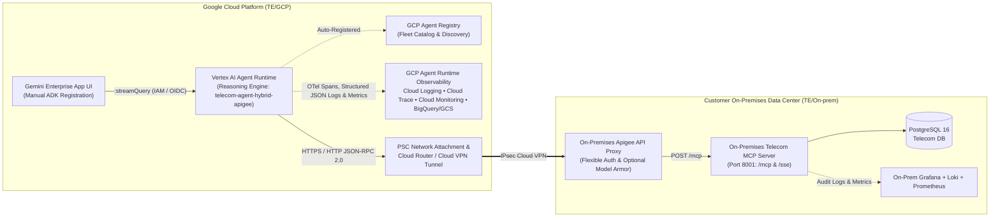

<!--
  Purpose: Architecture, configuration, Cloud Shell installation/uninstallation, observability, Agent Registry, and Gemini Enterprise registration guide for the GCP Telecom ADK Agent on Vertex AI Agent Runtime.
  Architecture/Context: Governs the GCP-resident Google ADK Agent (running exclusively on Vertex AI Agent Runtime) connecting over Cloud VPN to the On-Premises Apigee API Proxy and MCP Server (`TE/On-prem`).
  Dependencies/Side Effects: Requires Google Cloud SDK (`gcloud`), `uv`, and `google-agents-cli`.
-->

# Telecom Customer Care ADK Agent — GCP Agent Runtime (`TE/GCP`)

This directory ([`TE/GCP/`](file:///usr/local/google/home/pradeesi/Documents/jetski/TE/GCP)) contains the **Google Agent Development Kit (ADK) Agent** deployed exclusively on **Google Cloud Agent Runtime (Vertex AI Reasoning Engines)**.

The agent connects over **Google Cloud VPN** (via a Private Service Connect Network Attachment or routable Apigee ingress) to the **On-Premises Apigee API Proxy**, which governs access to the **On-Premises Telecom MCP Server** ([`TE/On-prem/`](file:///usr/local/google/home/pradeesi/Documents/jetski/TE/On-prem)). Once deployed on GCP Agent Runtime via [`./install.sh`](file:///usr/local/google/home/pradeesi/Documents/jetski/TE/GCP/install.sh), the agent is automatically registered in **GCP Agent Registry**, monitored with **GCP Agent Runtime Logging, Cloud Trace, and Cloud Monitoring**, and ready for manual registration into the **Gemini Enterprise App** UI.

---

## Application Architecture



### Core Architectural Capabilities

1. **Strict 8-Tool Telecom Domain Scope**:
   - The ADK Agent (`gemini-2.5-flash`) is strictly bounded to the 8 telecom customer-care MCP tools (`search_customer`, `get_customer_360`, `get_service_diagnostics`, `run_remote_device_action`, `check_network_outages`, `get_billing_breakdown`, `get_upsell_recommendations`, `log_agent_interaction`).
   - Any out-of-scope prompt is deterministically refused with a standardized compliance message.
2. **Cloud VPN Connectivity to On-Premises Apigee**:
   - Supports **Private Service Connect Interface (PSC-I)** Network Attachments (`--network-attachment`) so the managed Agent Runtime instance routes directly to private RFC 1918 on-premises Apigee IP addresses over **Cloud VPN** or **Cloud Interconnect**, with configurable SSL verification (`APIGEE_VERIFY_SSL`).
3. **Flexible Apigee Authentication (`APIGEE_AUTH_MODE`)**:
   - Because on-premises Apigee authentication policies can vary across environments, [`app/config.py`](file:///usr/local/google/home/pradeesi/Documents/jetski/TE/GCP/app/config.py) and [`app/tools.py`](file:///usr/local/google/home/pradeesi/Documents/jetski/TE/GCP/app/tools.py) support plug-and-play authentication modes via `.env` without code changes:
     - `auto` *(default)*: Automatically attaches credentials based on which environment variables are populated (`APIGEE_API_KEY`, `MCP_AUTH_TOKEN`, `APIGEE_BEARER_TOKEN`, `APIGEE_CUSTOM_HEADER_NAME`, or `APIGEE_BASIC_USER`), or sends unauthenticated requests if none are set.
     - `none`: Sends no authentication headers (for Cloud VPN network-level trust or mTLS).
     - `api_key`: Sends `APIGEE_API_KEY` in the header specified by `APIGEE_API_KEY_HEADER` (default: `x-apikey`).
     - `bearer`: Sends `Authorization: Bearer <token>` and `X-MCP-Token: <token>`.
     - `google_id_token`: Mints a Google OIDC ID token from the Agent Runtime metadata server and sends `Authorization: Bearer <id_token>`.
     - `basic`: Sends `Authorization: Basic <base64(user:password)>`.
     - `custom_header`: Sends `<APIGEE_CUSTOM_HEADER_NAME>: <APIGEE_CUSTOM_HEADER_VALUE>`.
4. **GCP Agent Registry Integration**:
   - Enables `agentregistry.googleapis.com` and deploys to Vertex AI Agent Runtime with SPIFFE Agent Identity (`--agent-identity`), registering the agent in **GCP Agent Registry** for centralized fleet governance.
5. **Full Agent Runtime Logging, Tracing & Monitoring**:
   - **Cloud Trace**: OpenTelemetry spans (`invoke_agent`, `call_llm`, `execute_tool`) exported automatically via `GOOGLE_CLOUD_AGENT_ENGINE_ENABLE_TELEMETRY=true`.
   - **Cloud Logging**: Structured JSON logs emitted on every MCP tool invocation (`mcp_tool_call_started`, `mcp_tool_call_completed`, `mcp_tool_call_http_error`, `mcp_tool_blocked_by_model_armor`) correlated with `logging.googleapis.com/trace`.
   - **Cloud Monitoring**: Custom log-based metrics (`telecom_agent_mcp_tool_calls_total`, `telecom_agent_mcp_tool_errors_total`, `telecom_agent_model_armor_blocks_total`) and a pre-built **Cloud Monitoring Dashboard** (`Telecom ADK Agent Runtime & Apigee VPN Observability`) provisioned automatically by [`install.sh`](file:///usr/local/google/home/pradeesi/Documents/jetski/TE/GCP/install.sh).
   - **GCS & BigQuery Telemetry**: Full GenAI prompt/response completion logging to GCS (`gs://<PROJECT_ID>-telecom-agent-logs`) and a Cloud Logging BigQuery sink (`telecom_agent_hybrid_apigee_telemetry`) provisioned automatically by [`install.sh`](file:///usr/local/google/home/pradeesi/Documents/jetski/TE/GCP/install.sh).

---

## Project Directory Structure

```text
TE/GCP/
├── .env.example                          # Template environment configuration (Cloud VPN, Apigee Auth, Telemetry)
├── .gitignore                            # Excludes .env, virtualenvs, caches, and deployment_metadata.json
├── Dockerfile                            # Container definition required by `agents-cli deploy` for Agent Runtime
├── README.md                             # Architecture, Cloud Shell installation, and Gemini Enterprise guide
├── agents-cli-manifest.yaml              # Google Agents CLI manifest (deployment_target: agent_runtime)
├── install.sh                            # Interactive Cloud Shell installer (numbered GCP project menu)
├── uninstall.sh                          # Interactive Cloud Shell uninstaller (numbered GCP project menu)
├── pyproject.toml                        # Python package dependencies (google-adk[gcp,mcp], a2a-sdk, telemetry)
├── uv.lock                               # Locked deterministic dependency graph
├── app/                                  # ADK Agent application package
│   ├── __init__.py                       # Exports root AdkApp
│   ├── agent.py                          # Root LlmAgent definition, Gemini 2.5 Flash config & strict scope prompt
│   ├── config.py                         # Pydantic settings for Apigee URL, flexible auth modes & telemetry
│   ├── fast_api_app.py                   # Agent Runtime container entrypoint (:query, :streamQuery, A2A routes)
│   ├── tools.py                          # 8 telecom MCP tools with flexible Apigee auth & structured GCP logging
│   └── app_utils/                        # Agent Runtime adapters and OpenTelemetry instrumentation
│       ├── a2a.py                        # Agent-to-Agent (A2A) protocol & /.well-known/agent-card.json routes
│       ├── reasoning_engine_adapter.py   # Vertex AI Reasoning Engine (:query & :streamQuery) adapter
│       ├── services.py                   # Shared VertexAiSessionService and GcsArtifactService wiring
│       ├── telemetry.py                  # Agent Runtime Cloud Trace, Cloud Logging & GCS completion setup
│       └── typing.py                     # Feedback payload schema for Cloud Logging -> BigQuery sink
├── skills/
│   └── telecom_customer_care_agent/
│       └── SKILL.md                      # Optional turn-by-turn Contact Center playbook for Gemini Enterprise
└── tests/
    └── unit/
        └── test_agent.py                 # Unit tests for 8 MCP tools, scope guard & flexible Apigee auth modes
```

---

## Frameworks & Libraries

- **Agent Framework**: [Google Agent Development Kit (ADK)](https://adk.dev/) (`google-adk[gcp,mcp]>=2.0.0,<3.0.0`)
- **Foundation Model**: `gemini-2.5-flash` via `google-genai` and Vertex AI
- **Managed Runtime**: [Vertex AI Agent Runtime (Reasoning Engines)](https://cloud.google.com/vertex-ai/generative-ai/docs/agent-engine/overview) (`google-cloud-aiplatform[evaluation,agent-engines]>=1.156.0`)
- **Interop & Transport**: `a2a-sdk[http-server]~=0.3.22`, `httpx>=0.27.0`, `fastapi`, `uvicorn`
- **Observability**: `opentelemetry-instrumentation-google-genai>=0.1.0`, `google-cloud-logging>=3.12.0`
- **Configuration & Packaging**: `pydantic-settings>=2.2.0`, `uv`, `google-agents-cli`

---

## Environment Variables

All configuration is externalized via environment variables or `.env` (copied from [`.env.example`](file:///usr/local/google/home/pradeesi/Documents/jetski/TE/GCP/.env.example) and updated interactively by [`./install.sh`](file:///usr/local/google/home/pradeesi/Documents/jetski/TE/GCP/install.sh)).

| Variable | Type | Default / Example | Purpose |
| :--- | :--- | :--- | :--- |
| `GOOGLE_GENAI_USE_VERTEXAI` | `bool` | `true` | Uses Vertex AI backend for Gemini model calls. |
| `GOOGLE_CLOUD_PROJECT` | `string` | `pradeesi-ai-demo` | **Required.** Target Google Cloud Project ID. |
| `GOOGLE_CLOUD_LOCATION` | `string` | `us-central1` | Target GCP region for Agent Runtime and Agent Registry. |
| `MODEL_NAME` | `string` | `gemini-2.5-flash` | Gemini model used by the ADK Agent. |
| `MCP_SERVER_URL` | `string` | `https://apigee.onprem.internal/telecom-mcp` | **Required.** Base URL of the On-Premises Apigee API Proxy reached over Cloud VPN. |
| `APIGEE_VERIFY_SSL` | `bool` | `true` | Set to `false` if the on-premises Apigee endpoint over Cloud VPN uses a self-signed or private CA TLS certificate. |
| `APIGEE_AUTH_MODE` | `string` | `auto` | Apigee authentication strategy: `auto`, `none`, `api_key`, `bearer`, `google_id_token`, `basic`, or `custom_header`. |
| `APIGEE_API_KEY` | `string` | *(empty)* | API Key value when `APIGEE_AUTH_MODE` is `api_key` or `auto`. |
| `APIGEE_API_KEY_HEADER` | `string` | `x-apikey` | Header name used to send `APIGEE_API_KEY`. |
| `MCP_AUTH_TOKEN` | `string` | *(empty)* | Static Bearer token sent as `Authorization: Bearer <token>` and `X-MCP-Token` when `APIGEE_AUTH_MODE` is `bearer` or `auto`. |
| `APIGEE_BEARER_TOKEN` | `string` | *(empty)* | Alias for `MCP_AUTH_TOKEN` in `bearer` or `auto` mode. |
| `APIGEE_OIDC_AUDIENCE` | `string` | *(empty)* | Target audience URI when `APIGEE_AUTH_MODE=google_id_token` (defaults to `MCP_SERVER_URL`). |
| `APIGEE_BASIC_USER` | `string` | *(empty)* | Username when `APIGEE_AUTH_MODE=basic`. |
| `APIGEE_BASIC_PASSWORD` | `string` | *(empty)* | Password when `APIGEE_AUTH_MODE=basic`. |
| `APIGEE_CUSTOM_HEADER_NAME` | `string` | *(empty)* | Custom auth header name when `APIGEE_AUTH_MODE=custom_header`. |
| `APIGEE_CUSTOM_HEADER_VALUE` | `string` | *(empty)* | Custom auth header value when `APIGEE_AUTH_MODE=custom_header`. |
| `NETWORK_ATTACHMENT` | `string` | `projects/.../networkAttachments/...` | Optional PSC Network Attachment resource name enabling Agent Runtime to route over Cloud VPN to private on-prem IPs. |
| `ENABLE_AGENT_IDENTITY` | `bool` | `true` | Enables SPIFFE workload identity (`--agent-identity`) on Agent Runtime. |
| `GOOGLE_CLOUD_AGENT_ENGINE_ENABLE_TELEMETRY` | `bool` | `true` | Enables native Agent Runtime Cloud Trace & Cloud Logging instrumentation. |
| `OTEL_INSTRUMENTATION_GENAI_CAPTURE_MESSAGE_CONTENT` | `string` | `EVENT_ONLY` | Controls GenAI message capture (`EVENT_ONLY`, `SPAN_AND_EVENT`, `SPAN_ONLY`, `NO_CONTENT`). |
| `LOGS_BUCKET_NAME` | `string` | `<PROJECT_ID>-telecom-agent-logs` | GCS bucket name storing full GenAI prompt/response JSONL completions. |

---

## No Hardcoding Rule

> [!IMPORTANT]
> **Zero Hardcoded Secrets**: No API keys, Bearer tokens, passwords, or project-specific credentials are hardcoded in the source code. Always configure runtime settings in `.env` (excluded via [`.gitignore`](file:///usr/local/google/home/pradeesi/Documents/jetski/TE/GCP/.gitignore)) or inject secrets from Google Cloud Secret Manager (`agents-cli deploy --secrets`).

---

## Local Verification & Testing

```bash
cd TE/GCP

# Sync Python virtual environment & run unit tests
uv sync --all-extras
uv run pytest tests/unit/test_agent.py -v
```

---

## Agent Runtime Deployment Playbook (Google Cloud Shell)

### Step 1: Configure Cloud VPN / Private Service Connect (If Apigee Uses a Private RFC 1918 IP)

Because Vertex AI Agent Runtime runs in a Google-managed tenant project, reaching a **private on-premises IP address over Cloud VPN** requires a **Private Service Connect (PSC) Network Attachment** in the VPC connected to your Cloud VPN tunnel:

```bash
export PROJECT_ID="your-gcp-project-id"
export REGION="us-central1"
export VPC_NAME="your-vpn-connected-vpc"
export PSC_SUBNET_NAME="telecom-agent-psc-subnet"
export ATTACHMENT_NAME="telecom-agent-vpn-attachment"

# 1. Create a dedicated subnet in your VPN-connected VPC (if not already present)
gcloud compute networks subnets create "${PSC_SUBNET_NAME}" \
  --project="${PROJECT_ID}" \
  --network="${VPC_NAME}" \
  --region="${REGION}" \
  --range="10.240.0.0/24"

# 2. Create the PSC Network Attachment with automatic producer acceptance
gcloud compute network-attachments create "${ATTACHMENT_NAME}" \
  --project="${PROJECT_ID}" \
  --region="${REGION}" \
  --subnets="${PSC_SUBNET_NAME}" \
  --connection-preference=ACCEPT_AUTOMATIC

# 3. Copy the full Network Attachment resource URI into .env:
# NETWORK_ATTACHMENT=projects/${PROJECT_ID}/regions/${REGION}/networkAttachments/${ATTACHMENT_NAME}
```

*(Note: Ensure your Cloud Router / Cloud VPN tunnel advertises the `${PSC_SUBNET_NAME}` CIDR range `10.240.0.0/24` to the on-premises network so return traffic from the on-premises Apigee proxy routes back to Agent Runtime).*

---

### Step 2: Configure Flexible Apigee Authentication in `.env`

Choose whichever authentication mechanism your Apigee engineer configures on the on-premises Apigee proxy:

- **Case 1 — No Authentication yet / Cloud VPN Network Trust (`APIGEE_AUTH_MODE=none` or `auto`)**:
  ```dotenv
  MCP_SERVER_URL=https://apigee.onprem.internal/telecom-mcp
  APIGEE_AUTH_MODE=none
  APIGEE_VERIFY_SSL=false
  ```
- **Case 2 — Apigee `VerifyAPIKey` Policy (`APIGEE_AUTH_MODE=api_key`)**:
  ```dotenv
  MCP_SERVER_URL=https://apigee.onprem.internal/telecom-mcp
  APIGEE_AUTH_MODE=api_key
  APIGEE_API_KEY=your-apigee-consumer-key
  APIGEE_API_KEY_HEADER=x-apikey
  ```
- **Case 3 — Static Bearer Token (`APIGEE_AUTH_MODE=bearer`)**:
  ```dotenv
  MCP_SERVER_URL=https://apigee.onprem.internal/telecom-mcp
  APIGEE_AUTH_MODE=bearer
  MCP_AUTH_TOKEN=your-bearer-token
  ```
- **Case 4 — Google OIDC ID Token (`APIGEE_AUTH_MODE=google_id_token`)**:
  ```dotenv
  MCP_SERVER_URL=https://apigee.onprem.internal/telecom-mcp
  APIGEE_AUTH_MODE=google_id_token
  ```

---

### Step 3: Run the Interactive Google Cloud Shell Installer (`./install.sh`)

From **Google Cloud Shell** (or any Linux terminal with `gcloud` authenticated):

```bash
git clone https://github.com/pradeesi/TE.git
cd TE/GCP
chmod +x install.sh uninstall.sh
./install.sh
```

What [`install.sh`](file:///usr/local/google/home/pradeesi/Documents/jetski/TE/GCP/install.sh) performs automatically:
1. **Interactive Numbered GCP Project Selector**: Queries all active GCP projects accessible to your account (`[ 1] project-id  Project Name`) and lets you select the target project by entering its number (or pass `--project <PROJECT_ID>`).
2. **Interactive Region & Apigee Proxy Prompt**: Lets you confirm/override the GCP deployment region (`1-5` or custom) and On-Premises Apigee Proxy URL (`MCP_SERVER_URL`), saving your choices to `.env`.
3. **Cloud Shell Prerequisite Setup & Pre-Flight Unit Tests**: Automatically installs/updates `uv` and `google-agents-cli`, syncs `.venv`, and runs the unit test suite (`tests/unit/test_agent.py`) before touching cloud resources.
4. **GCP API Enablement (with Retries)**: Enables `aiplatform.googleapis.com`, `agentregistry.googleapis.com`, `logging.googleapis.com`, `monitoring.googleapis.com`, `cloudtrace.googleapis.com`, `telemetry.googleapis.com`, `storage.googleapis.com`, `bigquery.googleapis.com`, and `secretmanager.googleapis.com`.
5. **Telemetry Storage, Log Sinks, Metrics & Cloud Monitoring Dashboard**:
   - Creates the GCS prompt/response completion bucket (`gs://<PROJECT_ID>-telecom-agent-logs`) and BigQuery dataset (`telecom_agent_hybrid_apigee_telemetry`).
   - Configures the Cloud Logging BigQuery sink (`telecom-agent-hybrid-apigee-reasoning-engine-logs`) and grants IAM writer permissions.
   - Creates the 3 Cloud Logging log-based metrics (`telecom_agent_mcp_tool_calls_total`, `telecom_agent_mcp_tool_errors_total`, `telecom_agent_model_armor_blocks_total`).
   - Creates or updates the **Cloud Monitoring Dashboard** (`Telecom ADK Agent Runtime & Apigee VPN Observability`).
6. **Fault-Tolerant Agent Runtime Deployment & Agent Registry Verification**: Deploys the ADK Agent (`agents-cli deploy`) with automatic polling recovery if the CLI hits a client wait timeout, verifies registration in **GCP Agent Registry**, and writes `deployment_metadata.json`.

---

### Step 4: Manual Registration with the Gemini Enterprise App UI

Once [`install.sh`](file:///usr/local/google/home/pradeesi/Documents/jetski/TE/GCP/install.sh) completes, it prints your **Reasoning Engine Resource ID** (also saved in `deployment_metadata.json`):

```text
projects/<PROJECT_NUMBER_OR_ID>/locations/<REGION>/reasoningEngines/<REASONING_ENGINE_ID>
```

To manually register the deployed Agent Runtime agent into your **Gemini Enterprise App**:

1. Open the **Google Cloud Console** and navigate to **Gemini Enterprise (Agentspace) &rarr; Apps**.
2. Select your target **Gemini Enterprise App** (or create one if not already created).
3. In the left navigation menu, click **Agents** &rarr; **+ Add Agent** (or **Register Agent**).
4. Choose **Vertex AI Agent Engine / ADK Agent (Reasoning Engine)**:
   - **Display Name**: `Telecom Customer Care Co-Pilot`
   - **Description**: `Enterprise telecom agent for subscriber lookup, line diagnostics, remote hardware remediation, billing breakdown, network outages, and upsell recommendations.`
   - **Reasoning Engine Resource Name**: Paste the `remote_agent_runtime_id` from `deployment_metadata.json` (`projects/<PROJECT>/locations/<REGION>/reasoningEngines/<ENGINE_ID>`).
5. *(Optional)* Under **System Instructions / Agent Playbook**, paste the turn-by-turn contact center guidance from [`skills/telecom_customer_care_agent/SKILL.md`](file:///usr/local/google/home/pradeesi/Documents/jetski/TE/GCP/skills/telecom_customer_care_agent/SKILL.md).
6. Click **Save / Publish**. Gemini Enterprise will now invoke your Agent Runtime agent natively over `:streamQuery` and propagate the signed-in human operator's Google Identity email (`X-Goog-Authenticated-User-Email`) through Cloud VPN and Apigee to the on-premises MCP Server and Loki audit logs.

---

### Step 5: Inspecting Agent Registry & Agent Runtime Observability on GCP

1. **GCP Agent Registry**:
   - View in Cloud Console: `https://console.cloud.google.com/vertex-ai/agents/agent-registry?project=${PROJECT_ID}`
2. **Cloud Logging (Reasoning Engine & MCP Tool Call Structured Logs)**:
   ```bash
   gcloud logging read \
     'resource.type="aiplatform.googleapis.com/ReasoningEngine"' \
     --project="${PROJECT_ID}" \
     --limit=25 \
     --format="table(timestamp, severity, jsonPayload.event, jsonPayload.tool_name, jsonPayload.duration_ms, jsonPayload.auth_mode)"
   ```
3. **Cloud Trace (End-to-End Distributed Spans)**:
   - Open **Cloud Console &rarr; Trace &rarr; Trace Explorer** (`https://console.cloud.google.com/traces/list?project=${PROJECT_ID}`) to inspect `invoke_agent`, `call_llm`, and `execute_tool` spans.
4. **Cloud Monitoring (Metrics & Dashboard)**:
   - Open **Cloud Console &rarr; Monitoring &rarr; Dashboards** and select **`Telecom ADK Agent Runtime & Apigee VPN Observability`**.

---

### Step 6: Uninstalling the Agent (`./uninstall.sh`)

To cleanly remove the deployed Agent Runtime Reasoning Engine, Agent Registry entry, Cloud Monitoring Dashboard, log-based metrics, log sink, and telemetry storage from Google Cloud Shell:

```bash
cd TE/GCP
./uninstall.sh
```

[`uninstall.sh`](file:///usr/local/google/home/pradeesi/Documents/jetski/TE/GCP/uninstall.sh) presents the same **numbered list of GCP projects**, asks for confirmation (or accepts `--project <PROJECT_ID> --yes`), and supports `--keep-data` if you want to retain historical logs in GCS/BigQuery while deleting the runtime.
