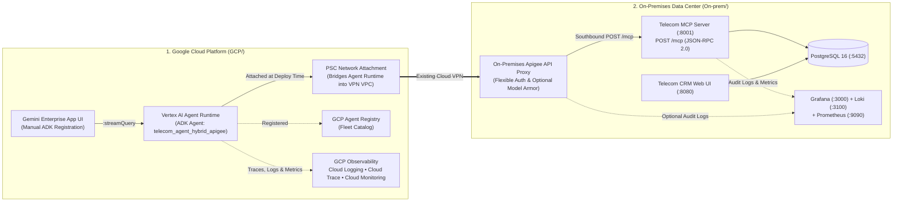

<!--
  Purpose: Top-level repository guide for the Hybrid Telecom Customer Care AI Platform (TE), linking the GCP Agent Runtime plane (`GCP/`) and the On-Premises Customer Data Center plane (`On-prem/`).
  Architecture/Context: Root landing documentation for https://github.com/pradeesi/TE.
  Dependencies/Side Effects: None.
-->

# Hybrid Telecom Customer Care AI Platform (`TE`)

End-to-end **Hybrid Cloud + On-Premises AI Reference Architecture** for an enterprise Telecom Contact Center. The repository is organized into two independent deployment planes connected over **Google Cloud VPN**:

1. **[`GCP/`](./GCP/) — Google Cloud Platform Plane (ADK Agent on Agent Runtime)**:
   - Hosts the **Google Agent Development Kit (ADK) Agent** (`telecom-agent-hybrid-apigee`, powered by `gemini-2.5-flash`) on **Vertex AI Agent Runtime (Reasoning Engines)**.
   - Registers the agent in **GCP Agent Registry** (`agentregistry.googleapis.com`) and enables full **GCP Agent Runtime Observability** (Cloud Logging, Cloud Trace, Cloud Monitoring log-based metrics & dashboards, and GCS/BigQuery prompt-response telemetry).
   - Sends traffic over your existing **Cloud VPN** (bridged into your VPN VPC via a pre-deployment **Private Service Connect (PSC) Network Attachment**) to the On-Premises Apigee API Proxy (`MCP_SERVER_URL`) with plug-and-play authentication (`APIGEE_AUTH_MODE`: `auto`, `none`, `api_key`, `bearer`, `google_id_token`, `basic`, `custom_header`).
   - Includes interactive **Google Cloud Shell** [`GCP/install.sh`](./GCP/install.sh) and [`GCP/uninstall.sh`](./GCP/uninstall.sh) scripts featuring a **numbered GCP project selector**.

2. **[`On-prem/`](./On-prem/) — Customer On-Premises Data Center Plane (MCP Server, CRM & Observability)**:
   - Standalone **6-container Docker Compose stack** for an On-Premises Ubuntu VM:
     - **PostgreSQL 16** (`5432`) — Telecom Customer Care, Billing, Network Outages & Diagnostics DB
     - **Telecom MCP Server** (`8001`) — FastMCP server exposing 8 telecom customer-care tools over Streamable HTTP JSON-RPC (`/mcp`) and SSE (`/sse`)
     - **Telecom Enterprise CRM** (`8080`) — FastAPI web dashboard for contact center supervisors
     - **Prometheus** (`9090`), **Grafana Loki** (`3100`), **Grafana** (`3000`), and **Portainer CE** (`9443` / `9000`)
   - Includes automated Ubuntu [`On-prem/install.sh`](./On-prem/install.sh) and [`On-prem/uninstall.sh`](./On-prem/uninstall.sh) scripts and the southbound Apigee handoff guide ([`On-prem/APIGEE_CONFIGURATION_GUIDE.md`](./On-prem/APIGEE_CONFIGURATION_GUIDE.md)).

---

## End-to-End Hybrid Architecture



---

## Repository Directory Structure

```text
TE/
├── README.md                                 # Top-level architecture & quick-start guide
├── GCP/                                      # Google Cloud Platform Plane (ADK Agent Runtime)
│   ├── README.md                             # Full GCP architecture, Cloud VPN, Registry & Gemini Enterprise guide
│   ├── install.sh                            # Interactive Cloud Shell installer (numbered GCP project menu)
│   ├── uninstall.sh                          # Interactive Cloud Shell uninstaller (numbered GCP project menu)
│   ├── .env.example                          # Template environment variables (Apigee URL, Auth Mode, Telemetry)
│   ├── agents-cli-manifest.yaml              # Google Agents CLI manifest (deployment_target: agent_runtime)
│   ├── Dockerfile                            # Container definition packaged by `agents-cli deploy` for Agent Runtime
│   ├── pyproject.toml                        # Python dependencies (google-adk, a2a-sdk, opentelemetry)
│   ├── app/                                  # ADK Agent code, flexible Apigee auth & GCP telemetry wiring
│   ├── skills/telecom_customer_care_agent/   # Contact Center playbook for Gemini Enterprise
│   └── tests/unit/                           # Unit tests for 8 MCP tools & flexible Apigee auth modes
└── On-prem/                                  # On-Premises Data Center Plane (Ubuntu VM Docker Stack)
    ├── README.md                             # Full On-Premises installation, verification & operations guide
    ├── APIGEE_CONFIGURATION_GUIDE.md         # Foolproof southbound Apigee -> MCP Server configuration guide
    ├── install.sh                            # Automated Ubuntu VM installer (Docker + 6-container stack)
    ├── uninstall.sh                          # Automated Ubuntu VM uninstaller
    ├── docker-compose.yml                    # Production Compose stack (restart: always, 0.0.0.0 bindings)
    ├── Dockerfile.mcp                        # Telecom MCP Server image definition
    ├── Dockerfile.crm                        # Telecom CRM Web UI image definition
    ├── monitoring/                           # Prometheus, Loki, and Grafana dashboards & datasources
    └── src/                                  # FastMCP server, CRM web app, and PostgreSQL seed models
```

---

## Quick Start

### 1. Deploy the On-Premises MCP & CRM Stack (Ubuntu VM)

```bash
git clone https://github.com/pradeesi/TE.git
cd TE/On-prem
chmod +x install.sh uninstall.sh
sudo ./install.sh
```

- **Detailed On-Prem Guide**: [`On-prem/README.md`](./On-prem/README.md)
- **Southbound Apigee Configuration Guide**: [`On-prem/APIGEE_CONFIGURATION_GUIDE.md`](./On-prem/APIGEE_CONFIGURATION_GUIDE.md)

### 2. Deploy the GCP ADK Agent on Agent Runtime (Google Cloud Shell)

```bash
git clone https://github.com/pradeesi/TE.git
cd TE/GCP
chmod +x install.sh uninstall.sh

# Interactive installer (displays a numbered list of your GCP projects)
./install.sh

# Interactive uninstaller
./uninstall.sh
```

- **Detailed GCP Agent Runtime, Agent Registry & Gemini Enterprise Guide**: [`GCP/README.md`](./GCP/README.md)
